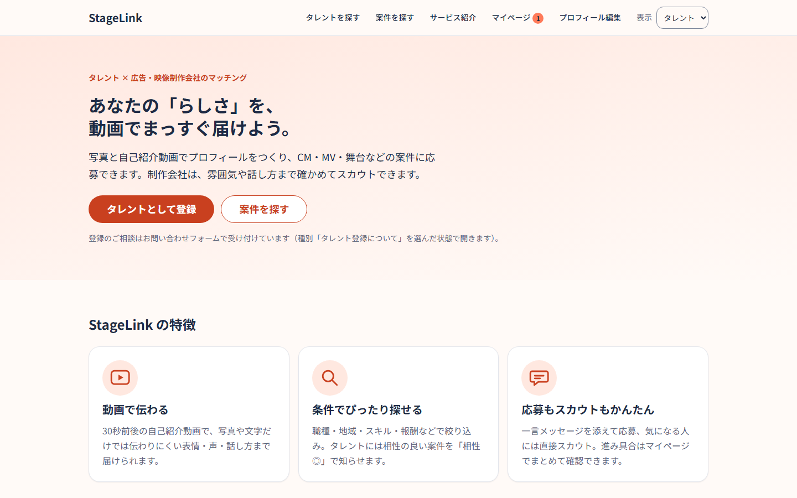
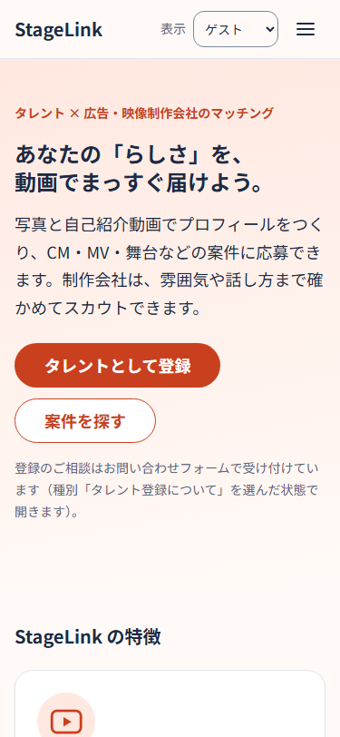
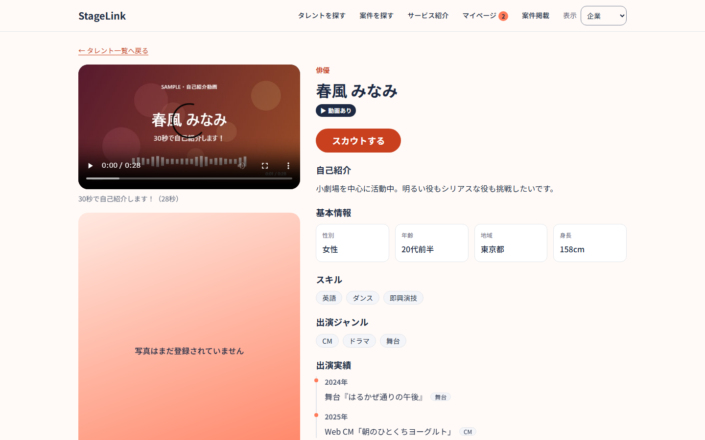
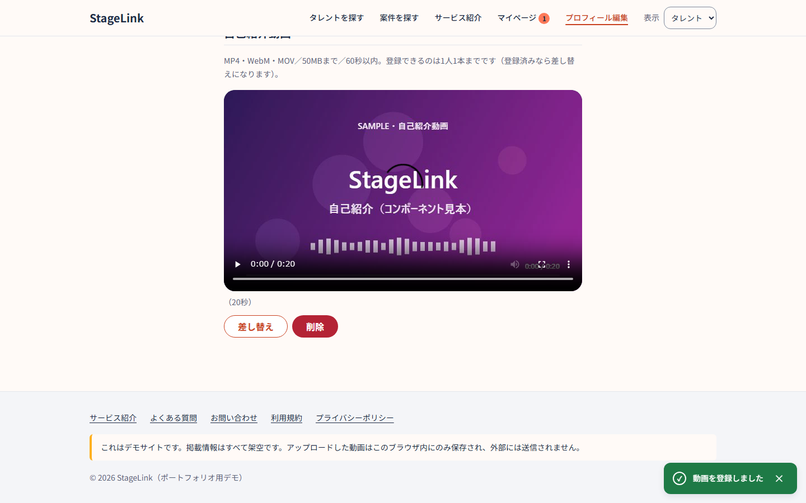
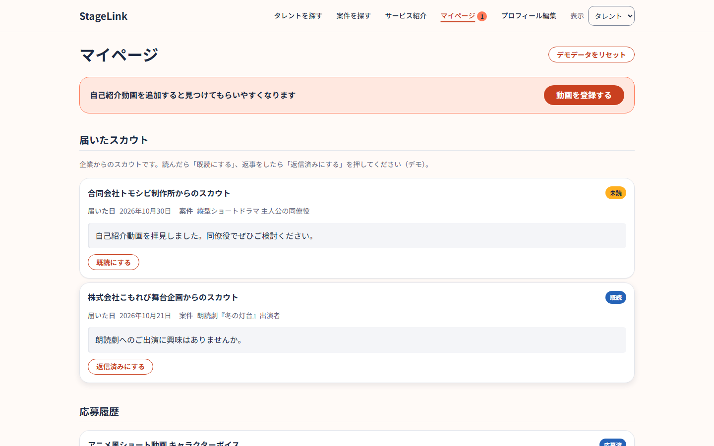
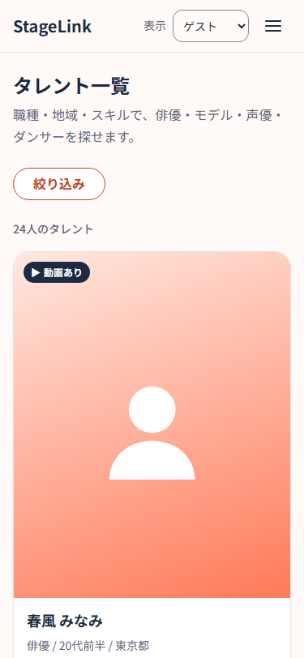
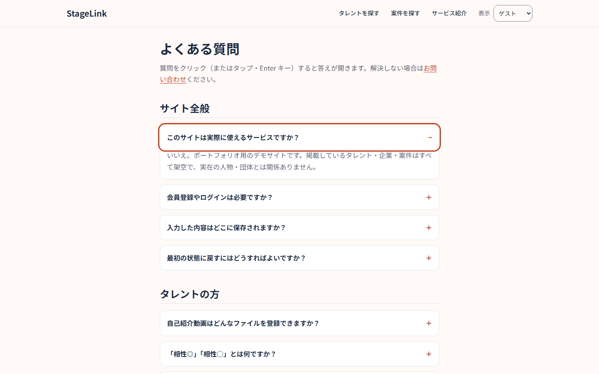
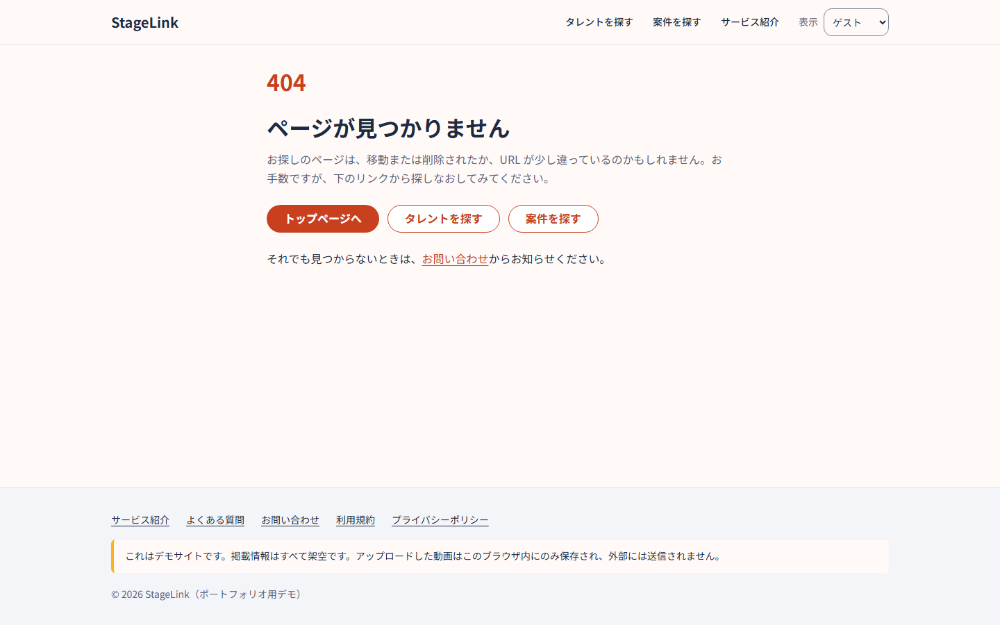

# StageLink（タレントマッチングのデモサイト）

タレント（俳優・モデル・ダンサーなど）と、広告・映像制作会社をつなぐマッチングサイトのデモです。
写真とプロフィールに加えて **30秒前後の自己紹介動画** を載せられるので、書類だけでは伝わりにくい表情・声・話し方まで確かめてから応募やスカウトに進めます。

> これは **ポートフォリオ用のデモサイト** です。掲載しているタレント・企業・案件はすべて架空で、実在の人物・団体とは関係ありません。
> バックエンドはなく、入力した内容は閲覧者のブラウザ内にのみ保存され、外部へは送信されません。

## スクリーンショット

| トップ（PC） | トップ（スマホ 375px） |
|---|---|
|  |  |

| タレント詳細（企業として表示） | 自己紹介動画の登録 |
|---|---|
|  |  |

| マイページ（タレント） | タレント一覧（スマホ） |
|---|---|
|  |  |

| よくある質問 | 404 |
|---|---|
|  |  |

## 主な機能

- **タレントを探す**：職種・性別・年齢帯・地域・キーワード・スキル・「動画ありのみ」で絞り込み（条件は URL のクエリに保持）
- **案件を探す・応募する**：一言メッセージを添えて応募。タレントには相性の良い案件に「相性◎／相性○」バッジ
- **自己紹介動画**：MP4 / WebM / MOV、50MB・60秒以内をその場でチェックし、プレビュー → 登録・差し替え・削除
- **スカウト**：企業として表示中に、タレント詳細から自社の案件を添えてスカウト
- **マイページ**：応募・スカウトの状況管理、おすすめ案件、通知バッジ、デモデータのリセット
- **案件掲載**（企業）・**プロフィール編集**（タレント）・**お問い合わせ**（入力 → 確認 → 完了）
- **静的ページ**：サービス紹介・よくある質問・利用規約・プライバシーポリシー・404

## 使用技術

| 分類 | 内容 |
|---|---|
| マークアップ | HTML（セマンティック要素・ARIA） |
| スタイル | CSS（カスタムプロパティによるデザイントークン、BEM 風の命名） |
| スクリプト | 素の JavaScript（ES Modules、ビルドなし） |
| 保存 | localStorage / sessionStorage / IndexedDB |
| フォント | Google Fonts（Noto Sans JP） |
| テスト | Node.js 標準のテストランナー（`node --test`） |
| 開発サーバー | Node.js 標準モジュールだけで書いた静的サーバー（`scripts/dev-server.mjs`） |

依存パッケージは **ひとつもありません**（`package.json` に dependencies なし）。

### フレームワークを使わなかった理由

- **規模に対して十分**：画面は16ページで、データはすべてブラウザ内で完結します。サーバーとの同期や大規模な状態管理が要らないため、フレームワークの利点（仮想 DOM・ルーティング・SSR など）を活かす場面が少ないと判断しました。
- **基礎力を見せるため**：DOM 操作・イベント・フォーカス管理・アクセシビリティ・セキュリティ対策を、ライブラリに任せず自分で実装して説明できる形にしたかったためです。
- **公開と保守が軽い**：ビルド工程がないので、GitHub Pages にファイルを置くだけで動きます。依存パッケージがないため、脆弱性対応や更新の手間もかかりません。
- 代わりに、**CSS 変数のデザイントークン**・**1ファイル1責務の ES Modules**・**純粋関数＋テスト** を組み合わせ、フレームワークがなくても破綻しない構成にしています。

## 工夫した点

### デザイントークン
- 色・余白・角丸・影・文字サイズを `css/variables.css` に集約しました。色は「プリミティブ（`--palette-*`）」と「用途（`--color-primary` など）」の2段に分け、各画面は用途のトークンだけを使います。
- 生の HEX 値や `gray-*` のような場当たり的な色指定が `variables.css` 以外に無いことを、テストで機械的に確認しています。

### アクセシビリティ
- 全ページに `header` / `nav` / `main` / `footer` のランドマークを置き、h1 は1ページに1つにしています。最初の Tab で「本文へスキップ」リンクに移ります。
- フォームはすべて `<label>` 付きです。エラーは文字で表示し、入力欄と `aria-describedby` で関連付けています。
- 状態は色だけで伝えません（ステータスは文字を併記し、選択中のタブ・ナビには太字や下線も付けます）。
- コントラスト比が WCAG AA（文字 4.5:1、アイコン・枠 3:1）を満たすことを、トークンの組み合わせと実際の CSS ルールの両方でテストしています。
- 動画は自動再生しません。FAQ は `<details>` / `<summary>` を使っているので、JS なしでもキーボードで開閉できます。

### セキュリティ
- **エスケープ**：ユーザー入力は `textContent` で表示します。HTML 文字列を組み立てる箇所では、必ず `utils.js` のエスケープ関数を通します。
- **CSP**：全ページに `Content-Security-Policy` の `<meta>` を設定しています（スクリプトは同一オリジンのみ、インラインスクリプト・インライン style 属性なし、`object-src 'none'`、`base-uri 'self'`、`form-action 'self'`）。
- **保存値の再検証**：localStorage / sessionStorage の値は利用者が書き換えられる前提で扱い、読み出すたびに型・形式を確かめて、不正な値は無視します。
- **外部送信なし**：問い合わせ・応募・動画などの入力内容はどこにも送信しません（外部との通信は Google Fonts の読み込みだけです）。
- 開発サーバーは `127.0.0.1` で待ち受け、Host ヘッダーを検査して DNS リバインディングを防いでいます。

### 自己紹介動画・マッチング
- 動画は IndexedDB に保存し、プレビュー用のオブジェクト URL は差し替え時・ページ離脱時に解放します。IndexedDB が使えない環境では、その旨を画面で案内します。
- マッチ度スコア（職種・地域・性別・スキル・ジャンル・動画の有無など）で案件を並べ、相性バッジとおすすめ表示に使っています。

### TDD
- ロジック（`js/lib/*`）は先にテストを書いてから実装しました。リンク切れ・`<head>` の共通設定（description・OGP・CSP）・コントラストもテストで確認しています。

## デモの操作方法

1. **ロール切替**：ヘッダー右の「表示」で **ゲスト／タレント／企業** を切り替えます（会員登録・ログインの代わりのデモ用機能です）。
   - タレント：案件への応募、プロフィール編集、自己紹介動画の登録、マイページ
   - 企業：タレントへのスカウト、案件掲載、応募者の管理（マイページ）
2. **動画登録**：タレントに切り替えて「プロフィール編集」→「自己紹介動画」で動画を選び、公開に同意して登録します。
3. **デモリセット**：マイページの「デモデータをリセット」で、応募・スカウト・掲載案件・プロフィール・動画をすべて初期状態に戻せます。

## ローカルでの確認方法

`file://` で直接開くと ES Modules が読み込めないため、HTTP サーバー経由で開いてください。

### A. npm run dev（推奨）
- 必要なもの：**Node.js 20 以上**（依存パッケージがないので `npm install` は不要です）

```bash
npm run dev
# → http://127.0.0.1:8000/ をブラウザで開く（Ctrl+C で停止）
# ポートを変える場合（PowerShell）：$env:PORT=8001; npm run dev
```

### B. VS Code の Live Server
1. VS Code に拡張機能「Live Server」を入れる
2. このフォルダ（`index.html` がある階層）を VS Code で開く
3. `index.html` を右クリック →「Open with Live Server」

### テスト

```bash
npm test
```

## 素材の出典

- **サンプル動画・サムネイル**（`assets/videos/`・`assets/images/videos/`）：このプロジェクトで生成したオリジナル素材です（実在の人物は写っていません）。
- **アイコン**：インライン SVG で自作しました（外部アイコンライブラリは使っていません）。
- **フォント**：[Google Fonts](https://fonts.google.com/) の **Noto Sans JP**（SIL Open Font License 1.1）。
- 掲載しているタレント名・企業名・作品名はすべて架空です。

## GitHub Pages での公開手順

> push と公開設定は、リポジトリの持ち主が手動で行ってください。

1. GitHub で新しいリポジトリを作成する（例：`talent_matching`）。
2. このフォルダをリポジトリに push する（ルート直下に `index.html` がある状態にする）。
3. GitHub のリポジトリ画面で **Settings → Pages** を開く。
4. **Build and deployment** の Source を **Deploy from a branch**、Branch を **main** / **/(root)** にして Save。
5. 数分後に表示される URL（`https://<ユーザー名>.github.io/<リポジトリ名>/`）を開き、ロール切替・応募・スカウト・動画登録・お問い合わせが動くことを確認する。
6. 公開 URL が決まったら、必要に応じて各ページの `<head>` に `og:url` と `og:image`（絶対 URL）を追加する（追加する位置は各ページにコメントで示してあります）。

### 404 ページについて
- `404.html` は、全ページがルート直下にあるフラットな構成に合わせて、CSS・JS・リンクを **相対パス** で参照しています。そのため `https://…/<リポジトリ名>/xxx.html` のようなファイル名の打ち間違い（このサイトで起こる 404 のほとんど）では正しく表示されます。
- `…/<リポジトリ名>/a/b/xxx` のように **存在しない階層の URL** で 404 になった場合は、相対パスが解決できず、スタイルなしで表示されます。リポジトリ名が確定した後でこれも直したい場合は、`404.html` の `<head>` に `<base href="/<リポジトリ名>/">` を1行足してください（ただしその場合、ローカルの `npm run dev` / Live Server では 404 ページのスタイルが外れます）。
